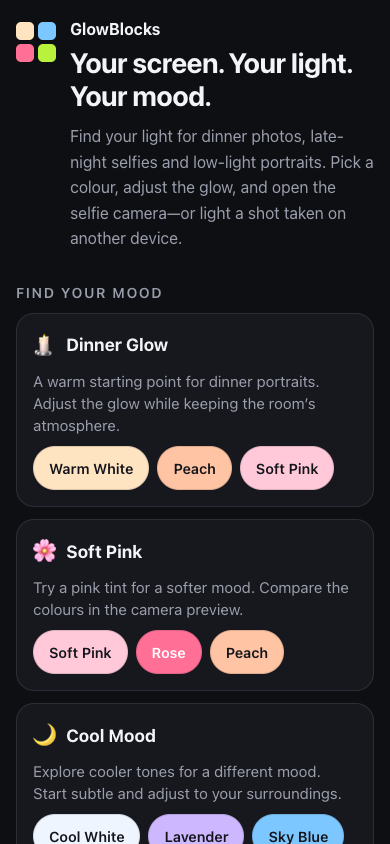
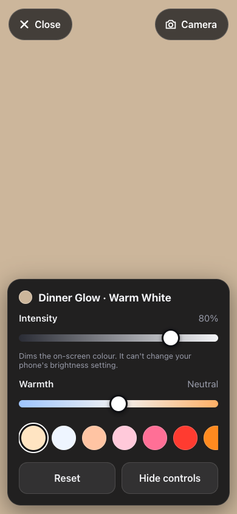

# GlowBlocks

[Try GlowBlocks](https://selinayang77.github.io/glowblocks/)

**Your screen. Your light. Your mood.**

A mobile-first web app for screen-lit selfies and atmospheric portraits in low-light settings.

Choose a colour, adjust the glow, and use the built-in selfie camera—or turn your device into a light source for a photo taken on another camera.

<p>
  
  
</p>

Actual app screenshots at a 390 × 844 mobile browser viewport.

## Why I built it

GlowBlocks was inspired by a social-media photography workaround: opening a solid-colour image and using the screen as a light source.

I wanted to bring that process into one interface, with colours to explore, adjustable light settings and a selfie camera. The project focuses on a simple moment: finding a look you like when taking a photo in a dim restaurant or at night.

## Two ways to use it

**Take a selfie**
1. Choose a colour or mood preset.
2. Open Camera and allow camera access.
3. Adjust the light intensity and frame your shot.
4. Take a photo, review it, then download or share it where supported.

**Light a photo taken on another device**
1. Open a colour and adjust the glow.
2. Hide the controls.
3. Position the screen near your subject and take the photo with another device.

## Features

- 18 colour presets and four mood starting points.
- Custom colours with recently used colours saved locally.
- Adjustable on-screen intensity and warmth.
- Front-camera preview with a self-timer.
- Photo capture, retake and download.
- Native file sharing where supported.
- Fullscreen and screen wake-lock requests where supported.

## Design choices

**Keep the light visible.**
The selfie preview occupies part of the screen, leaving colour around it to illuminate the subject. Preview size and available light are a practical trade-off.

**Make experimentation easy.**
Presets offer starting points. Users can adjust the colour and intensity for their surroundings.

**Keep the workflow lightweight.**
The application uses browser capabilities for camera access and photo capture, without requiring an account.

## Limits

- The intensity control changes the displayed colour; it does not change the device’s hardware brightness.
- Results depend on screen brightness, distance, ambient lighting and the camera’s exposure and white balance.
- Mood presets are creative suggestions, not calibrated lighting settings.
- Camera, fullscreen, wake-lock, download and sharing behaviour vary by browser and device.
- Real-device testing is needed to assess photographic results.

## Run locally

Use a Node.js version compatible with the project’s Vite version.

```bash
npm ci
npm run dev
```

Create and preview a production build:

```bash
npm run build
npm run preview
```

Camera access requires a secure context, such as HTTPS or a trusted localhost origin. Opening the development server through an ordinary HTTP LAN address on a phone may allow the page to load while blocking the camera.

## Built with

React, TypeScript, Vite and browser camera APIs.

Created by Selina Yang with AI-assisted development.
